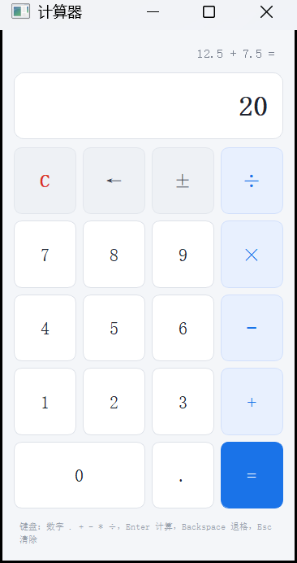
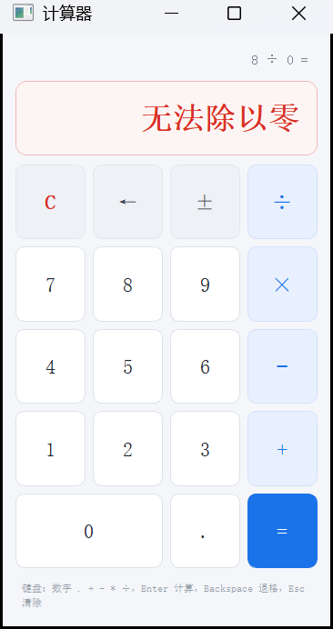
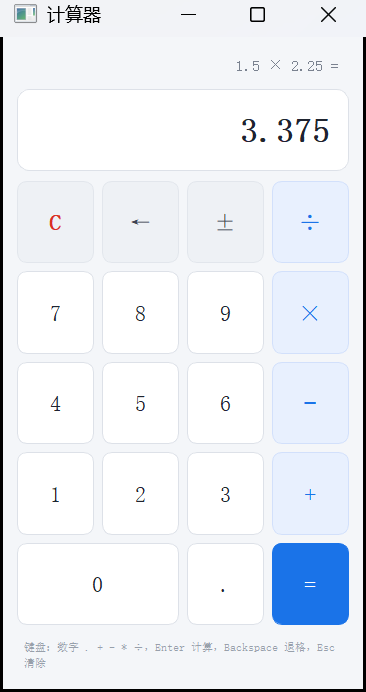

# 带键盘事件的计算器（Qt 实验一）

用 Qt Widgets 实现的四则运算计算器：界面由 Qt Designer（`mainwindow.ui`）完成布局，
鼠标点击与键盘输入共用同一套输入分发逻辑，边界输入有明确处理与提示。



## 功能

- 四则运算（`+` `−` `×` `÷`）、小数输入、退格、清除、正负号
- 双操作数状态管理，支持连续运算（`2 + 3 × 4` 逐步求值，结果可继续参与计算）
- 计算完成后直接输入数字即开始新的计算，输入运算符则以结果为第一操作数继续运算
- 键盘与鼠标行为完全一致（同一个 `dispatchInput()` 入口）
- 异常输入处理：重复小数点、连续运算符、除数为 0、结果溢出、超长数字、错误状态下的输入
- 样式表美化界面，出错时主显示区变红提示
- 自动化测试 32 个用例：引擎逻辑 24 个 + 界面集成（鼠标点击 / 键盘输入）8 个

## 键盘映射

| 按键 | 功能 |
| --- | --- |
| `0`–`9` | 输入数字 |
| `.` 或 `,` | 小数点 |
| `+` `-` `*` `/` | 加、减、乘、除 |
| `Enter` 或 `=` | 计算 |
| `Backspace` | 退格 |
| `Esc` 或 `Delete` | 清除 |
| `F9` | 正负号切换 |

## 运行效果

| 鼠标完成带小数运算 | 除数为 0 | 键盘计算 |
| --- | --- | --- |
|  |  |  |

## 目录结构

```
QtLab1Calculator.pro     工程文件（qmake，兼容 Qt 5.12 与 Qt 6.9）
main.cpp                 程序入口，加载样式表资源
mainwindow.h/.cpp/.ui    主窗口：界面排版、信号槽连线、键盘事件处理
calculator.h/.cpp        计算器核心引擎（与界面无关，可单独测试）
resources.qrc            资源文件，打包 styles/app.qss
styles/app.qss           界面样式表
tests/tests.pro          自动化测试工程
tests/tst_calculator.cpp 引擎单元测试 + 主窗口集成测试
docs/                    截图与开发记录
```

## 构建与运行

### Qt Creator（推荐）

1. `文件 → 打开文件或项目`，选择 `QtLab1Calculator.pro`
2. 选择 Kit（如 `Desktop Qt 5.12.11 MinGW 64-bit` 或 Qt 6.9.2 对应的 Kit），点击「配置项目」
3. 按 `Ctrl+R` 运行；界面可在「设计」模式下直接编辑 `mainwindow.ui`

### 命令行

```powershell
# 以 Qt 5.12.11 + MinGW 为例
$env:PATH = "D:\qt\5.12.11\mingw73_64\bin;D:\Qt\Tools\mingw730_64\bin;$env:PATH"
mkdir build; cd build
qmake ..\QtLab1Calculator.pro CONFIG+=release
mingw32-make -j4
.\release\QtLab1Calculator.exe
```

## 运行自动化测试

```powershell
$env:PATH = "D:\qt\5.12.11\mingw73_64\bin;D:\Qt\Tools\mingw730_64\bin;$env:PATH"
mkdir tests\build; cd tests\build
qmake ..\tests.pro CONFIG+=release
mingw32-make -j4
.\release\tst_calculator.exe
```

测试直接复用工程源码，覆盖四则运算、小数、退格、清除、连续运算、除零、
重复小数点、连续运算符、位数限制，以及「鼠标点击」与「键盘输入」两条路径结果一致。

## 边界输入处理

| 输入序列 | 现象 | 处理方式 |
| --- | --- | --- |
| `1.2.3` | 重复输入小数点 | 忽略第二个小数点，保留 `1.23`，底部提示原因 |
| `5 + + 8 =` | 连续输入运算符 | 用后一个运算符覆盖前一个，提示「已替换为 +」，结果 `13` |
| `8 ÷ 0 =` | 除数为 0 | 进入错误状态，显示红色「无法除以零」，表达式保留 `8 ÷ 0 =` |
| `2 × 3 = 5 + 2 =` | 计算完成后继续输入 | 数字开始新计算，运算符则以结果为第一操作数 |
| `7 + 2 × 3 + =` | 连续运算 | 每按一次运算符先结算前一步，再挂起新运算符 |
| 连续输入 17 位数字 | 超出精度 | 只保留 15 位并提示 |
| 计算结果后按退格 | 退格 | 保留结果并提示「结果不能退格」 |
| 错误状态下按退格 | 退格 | 视为清除，回到 `0` |
| `0.1 + 0.2 =` | 浮点误差 | 结果按 15 位有效数字格式化，显示 `0.3` |

## 实现要点

### 核心状态机（`CalculatorEngine`）

| 成员 | 含义 |
| --- | --- |
| `m_entry` | 正在输入的数字文本（保留用户写法，如 `0.10`） |
| `m_accumulator` | 第一个操作数，或连续运算的中间结果 |
| `m_pendingOp` | 已按下但尚未执行的运算符 |
| `m_freshEntry` | 下一次输入数字是否应重新开始写 |
| `m_justEvaluated` | 是否刚按过等号，用于「计算完成后继续输入」 |
| `m_errorState` | 除零、溢出等错误状态 |

### 鼠标与键盘复用同一套逻辑

按钮通过「对象名 → 输入记号」的映射，在构造函数里统一连接到 `dispatchInput()`：

```cpp
connect(button, &QPushButton::clicked, this, [this, token]() { dispatchInput(token); });
```

键盘事件则先翻译成同样的记号，再进入同一个入口：

```cpp
void MainWindow::keyPressEvent(QKeyEvent *event)
{
    const QString token = tokenFromKeyEvent(event);
    if (token.isEmpty()) {
        QMainWindow::keyPressEvent(event);
        return;
    }
    event->accept();
    dispatchInput(token);   // 与鼠标点击走同一个入口
}
```

两条路径最终都调用 `CalculatorEngine` 的同一组方法，因此不存在第二套计算逻辑。

## 版本说明

- 开发环境：Windows + Qt Creator 4.15 + Qt 5.12.11 (MinGW 7.3 64-bit)
- 代码同时兼容 Qt 6.9：`.pro` 中按 `QT_MAJOR_VERSION` 引入 widgets 模块，未使用 Qt 6 中已移除的 API
- 若本机安装的是 Qt 6.9.2，用对应 Kit 直接构建即可，源码无需改动
